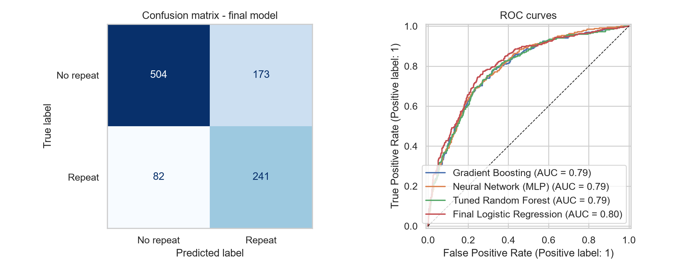
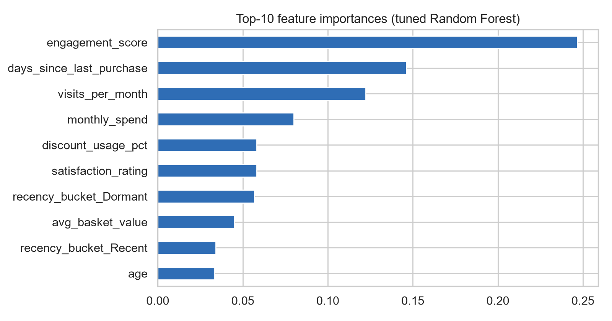

# Retail Customer Repeat-Purchase Prediction

Predicts whether a retail customer will buy again within the next **30 days**, so a store can send loyalty rewards to likely returners and win-back offers to customers who are drifting away.

Built during a six-week Python, AI & ML internship at Scoobies (Optimal Digitech Pvt. Ltd.), June–July 2026.

## Results

Seven classifiers were compared in one scikit-learn pipeline with stratified 5-fold cross-validation on 4,000 training customers, then evaluated on 1,000 held-out customers.

| Model | Accuracy | F1 | Test ROC-AUC | CV ROC-AUC |
|---|---|---|---|---|
| **Logistic Regression** | 0.750 | 0.558 | **0.804** | **0.816** |
| Neural Network (MLP) | 0.737 | 0.514 | 0.793 | 0.799 |
| Gradient Boosting | 0.743 | 0.550 | 0.789 | 0.803 |
| Random Forest | 0.738 | 0.542 | 0.779 | 0.791 |
| Support Vector Machine | 0.752 | 0.551 | 0.778 | 0.784 |
| K-Nearest Neighbours | 0.743 | 0.509 | 0.768 | 0.768 |
| Decision Tree | 0.725 | 0.513 | 0.744 | 0.752 |

Logistic Regression ranked first, and was then tuned with `GridSearchCV` (`C = 0.1`, `class_weight = "balanced"`) to handle the class imbalance (only 32% of customers return):

| Metric | Baseline | **Final model** |
|---|---|---|
| Recall (repeat buyers) | 0.49 | **0.75** |
| F1-score | 0.56 | **0.65** |
| ROC-AUC | 0.80 | **0.80** |
| Accuracy | 0.75 | 0.745 |

The final model finds 241 of the 323 returning customers in the test set. Engagement score, days since last purchase and visit frequency are the strongest drivers; demographics carry little weight.




## How it works

```
generate data → clean → engineer features → 7 models (5-fold CV) → tune best → save → predict
```

1. **Data** – `CustomerDataGenerator` builds a reproducible, anonymised dataset of 5,000 customers (seed 42) with demographics, channel, membership, visits, basket value, recency, discount use, satisfaction and complaints. Missing values, 60 duplicate rows and extreme basket values are injected on purpose so the cleaning step is realistic. No real customer data or personal information is used.
2. **Cleaning** – duplicates dropped, basket value capped at the 99th percentile.
3. **Feature engineering** – recency bucket (Recent / Lapsing / Dormant), monthly spend, and engagement score = visits ÷ (1 + recency/30).
4. **Pre-processing** – median/mode imputation, scaling and one-hot encoding inside a `ColumnTransformer`, fitted only on training folds (no data leakage).
5. **Modelling** – Logistic Regression, KNN, Decision Tree, Random Forest, Gradient Boosting, SVM and an MLP neural network; Random Forest and Logistic Regression are tuned with `GridSearchCV`.

## Getting started

Requires Python 3.10+.

```bash
pip install -r requirements.txt

python -m repeat_purchase.train      # ~30 s: trains, evaluates, writes figures/metrics, saves the model
python -m repeat_purchase.predict    # scores data/sample_customers.csv
python -m pytest                     # run the tests
```

Score your own customers (CSV with the same columns as `data/sample_customers.csv`):

```bash
python -m repeat_purchase.predict --input my_customers.csv --output my_customers.scored.csv
```

```
customer_id  repeat_probability  will_repeat         recommended_action
       N001              0.9557            1    Loyalty reward / upsell
       N002              0.0253            0 Win-back discount campaign
       N003              0.9307            1    Loyalty reward / upsell
```

## Project structure

```
├── repeat_purchase/
│   ├── config.py      # seed, feature lists, paths
│   ├── data.py        # data generator, cleaning, feature engineering
│   ├── models.py      # pre-processing pipeline and candidate models
│   ├── plots.py       # EDA and evaluation figures
│   ├── train.py       # end-to-end training pipeline (CLI)
│   └── predict.py     # batch scoring (CLI)
├── data/sample_customers.csv
├── reports/
│   ├── figures/       # generated charts
│   └── metrics/       # model_results.csv, summary.json
├── models/            # trained model (generated, not committed)
└── tests/
```

## Tech stack

Python · NumPy · Pandas · scikit-learn · Matplotlib · Seaborn · joblib · pytest

## Future work

- Retrain on real (anonymised) point-of-sale data and monitor drift
- Add basket-level and seasonal features
- Per-customer explanations with SHAP
- Serve the model through a Streamlit dashboard or FastAPI endpoint
